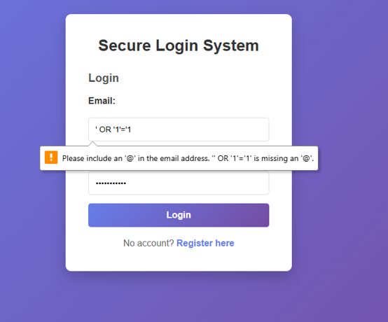
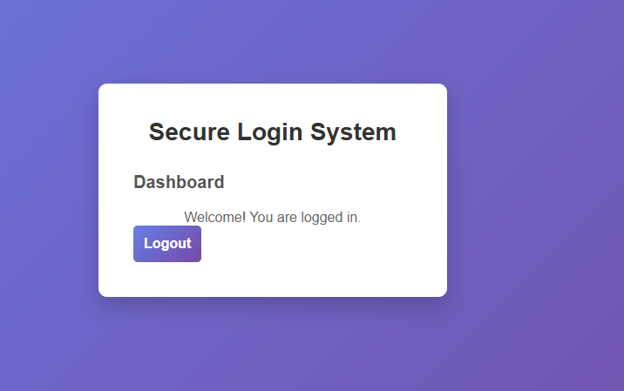
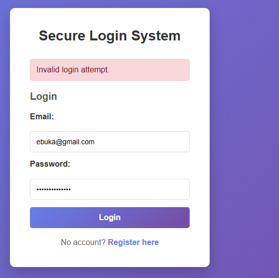
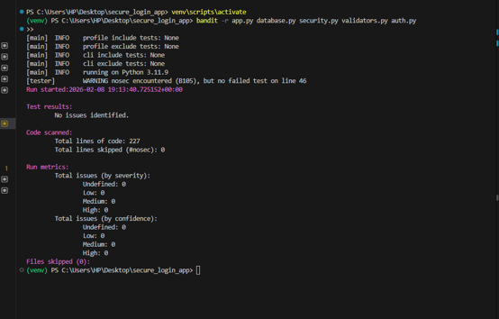
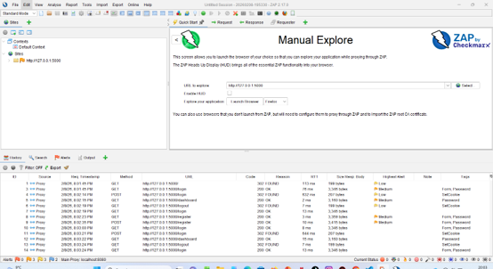

# Secure Login & Authentication System

**A Python Flask application demonstrating secure authentication, access control, and security testing.**

Developed as part of my BSc (Hons) Cybersecurity degree, this project involved designing, implementing, and evaluating a web-based authentication system using secure programming principles.

The objective was to understand how common authentication vulnerabilities can be reduced through secure coding, appropriate security controls, and practical testing.

> **Project scope:** University coursework and local security testing. This is a learning prototype, not a production-ready authentication service.

## Technologies & Tools

| Category | Technologies |
|---|---|
| Backend | Python, Flask |
| Database | SQLite |
| Password Security | bcrypt |
| Frontend | HTML, CSS |
| Static Security Testing | Bandit |
| Dynamic Security Testing | OWASP ZAP |
| Security Design | OWASP Top 10, STRIDE |

## Security Controls Implemented

The application incorporates several controls to address common authentication and web application risks.

- **Secure password storage:** bcrypt password hashing with individual salts instead of plaintext password storage.
- **Input validation:** Server-side email validation and password policy enforcement.
- **SQL injection mitigation:** Parameterised SQLite queries for database operations.
- **Authentication and access control:** User registration, login, logout, and session-based protection of the dashboard.
- **Account lockout:** Temporary 15-minute account lockout after five failed login attempts for existing accounts.
- **Security event logging:** Rotating log files for selected authentication and registration events.
- **Error handling:** Generic user-facing error responses and Flask debug mode disabled by default.

## Application Demonstration

### 1. Input Validation



The login form rejects incorrectly formatted email addresses, including the SQL injection-style input shown above.

This screenshot demonstrates browser-side email validation. SQL injection mitigation is implemented separately through parameterised database queries.

### 2. Successful Authentication



After successful authentication, users can access the protected dashboard. Session checks restrict access to authenticated users.

### 3. Invalid Login Handling



The application returns a generic error message when incorrect login credentials are submitted.

Failed authentication attempts are tracked, with temporary account lockout implemented to reduce repeated password-guessing attempts.

## Security Testing & Evaluation

Security testing was an important part of the project. I evaluated the application using manual functional testing, static code analysis, and dynamic application testing.

### 4. Static Code Analysis — Bandit



Bandit was used to analyse the Python application files for common security issues.

**Result:** The captured scan reported no identified issues in the scanned files following a configuration fix.

This result reflects the scope of that scan and does not guarantee that the application is vulnerability-free.

### 5. Dynamic Application Testing — OWASP ZAP



OWASP ZAP Manual Explore was used to inspect application traffic, including HTTP requests and responses during authentication workflows.

The testing session recorded low- and medium-severity alerts, highlighting areas for further investigation and hardening.

### Additional Functional Tests

The university project also included:

- Registration and login validation
- Incorrect credential handling
- Unauthenticated dashboard access checks
- SQL injection-related input testing
- Password hashing verification
- Account lockout behaviour

## Application Design

The project follows a modular structure to separate application functionality from security-related components.

```text
secure-login-system/
├── app.py
├── database.py
├── security.py
├── validators.py
├── requirements.txt
├── .gitignore
├── templates/
│   ├── base.html
│   ├── login.html
│   ├── register.html
│   └── dashboard.html
└── screenshots/
```

**Key components:**

- `app.py` — Application routes, authentication workflows, and session management.
- `database.py` — SQLite database operations using parameterised queries.
- `security.py` — Password hashing and verification.
- `validators.py` — Input validation and password policy enforcement.
- `templates/` — HTML templates for the application interface.

The design was informed by OWASP Top 10 risks and STRIDE threat modelling, particularly threats involving credential compromise, injection, and unauthorised access.

## Run Locally

**Prerequisite:** Python 3

1. Clone the repository:

   ```bash
   git clone https://github.com/worldbest402/secure-login-system.git
   cd secure-login-system
   ```

2. Create and activate a virtual environment:

   ```bash
   python -m venv venv
   ```

   Windows:

   ```powershell
   venv\Scripts\activate
   ```

3. Install dependencies:

   ```bash
   pip install -r requirements.txt
   ```

4. Configure a persistent `SECRET_KEY` environment variable for your local session.

5. Start the application:

   ```bash
   python app.py
   ```

6. Open:

   `http://127.0.0.1:5000`

Register a test account and explore the authentication functionality.

The application creates its SQLite database and security log files locally. These are excluded from version control.

## Limitations & Future Improvements

Although the application demonstrates several secure programming practices, additional controls would be required before production deployment.

Potential improvements include:

- CSRF protection for application forms
- Stronger session cookie configuration
- HTTP security headers
- Multi-factor authentication (MFA)
- Additional rate limiting and automated security tests

Flask's built-in development server is intended for local testing only.

## Key Learning Outcomes

Through this project, I gained practical experience in:

- Developing authentication functionality using Python and Flask
- Implementing password hashing and secure database queries
- Applying input validation and access control
- Using STRIDE and OWASP guidance to identify security risks
- Performing static analysis with Bandit
- Inspecting application behaviour with OWASP ZAP
- Evaluating security limitations and identifying improvements

---

**Project Type:** University Secure Programming Project  
**Focus:** Secure Software Development | Authentication | Application Security Testing  
**Author:** Ebuka Fidelis

